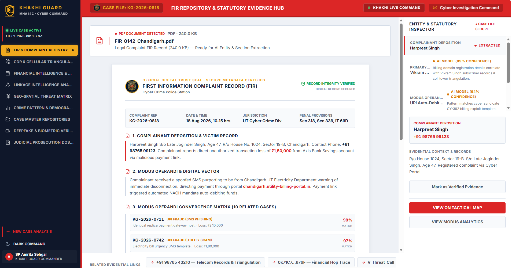
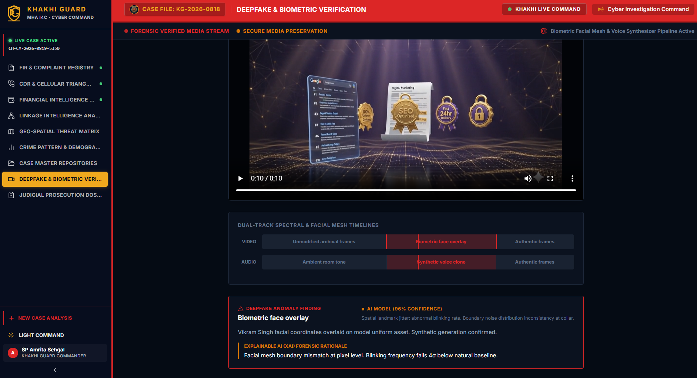
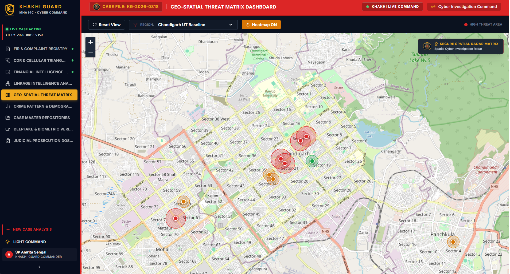
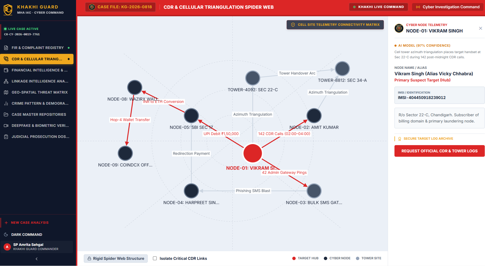
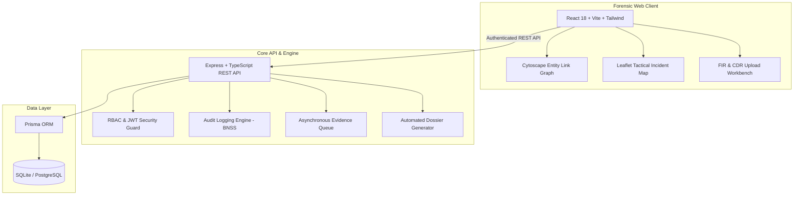

# KHAKHI GUARD — Digital Forensics & Cyber Crime Intelligence Platform
*(Formerly SUTRA.net)*

[](https://react.dev/)
[](https://www.typescriptlang.org/)
[](https://nodejs.org/)
[](https://www.prisma.io/)
[](https://js.cytoscape.org/)
[](https://leafletjs.com/)
[](#mha-i4c-compliance)
[](#achievements)

**KHAKHI GUARD** is an enterprise-grade cybercrime investigation and intelligence fusion platform developed for law enforcement agencies. Engineered to comply with Ministry of Home Affairs (MHA) Indian Cyber Crime Coordination Centre (I4C) standards and National Cyber Crime Reporting Portal (NCRP) taxonomy, the system unifies First Information Report (FIR) analysis, Call Detail Record (CDR) ingestion, financial transaction tracing, and entity network forensics into a centralized command dashboard.

---

## Key Capabilities

1. **Forensic Network Link Analysis (Cytoscape.js)**:
   - Dynamic node-link graph mapping connections between accused individuals, fraudulent bank accounts (mule accounts), burner IMEI/IMSI devices, and IP logs.
   - Centrality scoring to identify syndicate ringleaders and financial bridge nodes.
2. **Tactical Incident Geospatial Mapping (Leaflet)**:
   - Geofenced incident hotspots across jurisdictional boundaries with real-time cluster rendering.
3. **MHA I4C & Bharatiya Nagarik Suraksha Sanhita (BNSS) Compliance**:
   - Cryptographically verifiable audit logging preserving chain of custody for digital evidence under Bharatiya Sakshya Adhiniyam (BSA) Section 63B.
4. **Automated Evidence Dossier Generation**:
   - High-throughput PDF court-ready case summaries (investigation timeline, linked accused, charge sheets).
5. **Zero-Friction Dual-Mode Architecture**:
   - **Demo/Hackathon Mode**: Self-contained execution with seeded local SQLite persistence and mock forensics pipelines.
   - **Enterprise Mode**: PostgreSQL cluster with Redis BullMQ asynchronous workers for massive CDR datasets.

---

## Forensic Interface & Live Visuals

| Tactical Geospatial Mapping | Entity Linkage Forensics |
| :---: | :---: |
|  |  |
| *Jurisdictional incident cluster & hotspot telemetry* | *Multi-entity syndicate correlation & bridge detection* |

| Digital Intelligence Operations | Incident Context Inspector |
| :---: | :---: |
|  |  |
| *Unified cyber crime analytics & CDR ingestion* | *In-depth evidence details & demographic verification* |

---

## System Architecture



---

## Directory Layout

```
khakhi-guard-forensics/
├── backend/
│   ├── prisma/             # Schema definitions and migrations
│   ├── src/
│   │   ├── controllers/    # Case, FIR, CDR, and dossier endpoints
│   │   ├── middleware/     # RBAC verification & audit middleware
│   │   ├── services/       # Graph analytics & PDF generation
│   │   └── server.ts       # Express server initialization
│   ├── .env.example        # Environment variable template
│   ├── package.json        # Backend dependencies
│   └── tsconfig.json       # TypeScript compiler configuration
├── src/
│   ├── components/         # Cytoscape graph, Leaflet map, and dashboard views
│   ├── App.jsx             # Root UI state router
│   ├── index.css           # Tailwind forensic design palette
│   └── main.jsx            # Frontend entry point
├── public/                 # Static assets & map overlays
├── index.html              # HTML shell
├── package.json            # Frontend dependencies
├── tailwind.config.js      # Custom forensic theme tokens
└── vite.config.js          # Optimized bundling configuration
```

---

## Getting Started

### Prerequisites
- **Node.js**: v18.x or v20.x
- **npm** or **yarn**

### 1. Backend Setup

```bash
cd backend

# Install dependencies
npm install

# Copy environment configuration
cp .env.example .env

# Initialize database schema and generate Prisma client
npx prisma generate
npx prisma db push

# Start backend server
npm run dev
# -> Backend active on http://localhost:5000
```

### 2. Frontend Setup

```bash
# In the project root
npm install

# Start development client
npm run dev
# -> Frontend active on http://localhost:5173
```

---

## Achievements
- **Finalist** at the **Chandigarh Police Cyber Crime Hackathon (2026)**.

---

## License
MIT License. Authored and maintained by [Vijaya Saran P](https://github.com/vijayasaran-p).
